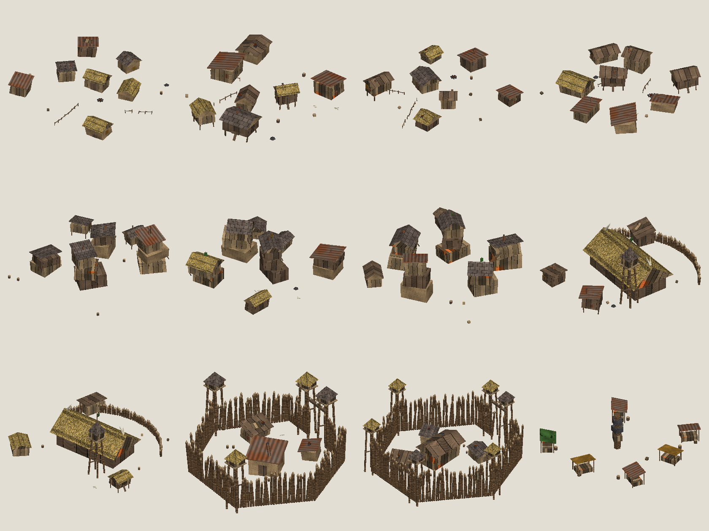

# Goblin city set



Goblin towns on the map use their own buildings instead of the European set: crooked plank shacks with scrap-metal lean-tos and sagging thatch, shacks on stilts, stacked shanty towers joined by plank catwalks, a chieftain's hall with bone horns and a teetering watchtower, stake palisades with gate towers, and a junk market around a totem.

Everything is generated by `tools/export_goblin_buildings.py` from seeded recipes. No Paradox meshes or textures are copied, and no Blender is needed.

```powershell
python tools/export_goblin_buildings.py --previews
```

This writes the meshes, the shared 512x512 texture atlas and the city script into `mod/`, and the preview PNGs and GLB files here. The GLB files open in Windows 3D Viewer or any glTF viewer.

## How EU5 picks the buildings

`main_menu/gfx/map/city_data/*.txt` defines `mesh_list`s and one `culture_data` per graphical culture. A location uses the `culture_data` of the highest-priority graphical-culture tag its culture carries that has one. The goblin cultures carry `european_gfx` plus their clan tag (`cm_cinderkin_gfx` and so on, priority 600), so `cm_ashborn_goblins.txt` adds a `culture_data` for each of the six clan tags.

| City piece | Model |
|---|---|
| Peasants (town and rural) | `cm_goblin_peasant_a`-`d` |
| Burghers | `cm_goblin_burgher_a`-`c` |
| Nobles | `cm_goblin_noble_a`-`b` |
| Stockade | `cm_goblin_stockade` |
| Fort | `cm_goblin_fort` |
| Market | `cm_goblin_market` |
| Small burgher building | `cm_goblin_burgher_a`/`c` |
| Ports, bridges, bastion/star fort/fortress, workshops, military | Vanilla Iroquois wooden set (`iroquois_*` mesh lists) until goblin versions exist |

To change the look, edit the recipes (`peasant`, `burgher`, `noble`, `stockade`, `market`, `shack`) or the atlas tiles in `tile_pixels`, then rerun.

## Status

Static only: the meshes round-trip through `tools/pdx_binary.py` and every vanilla mesh list the script names exists in EU5 1.3's `iroquois.txt`. In-game rendering is untested. Scale is matched to vanilla dioramas (a 2 x 2 tile, peasant shacks under 0.3 tall), but it may need tuning once seen on the map.
